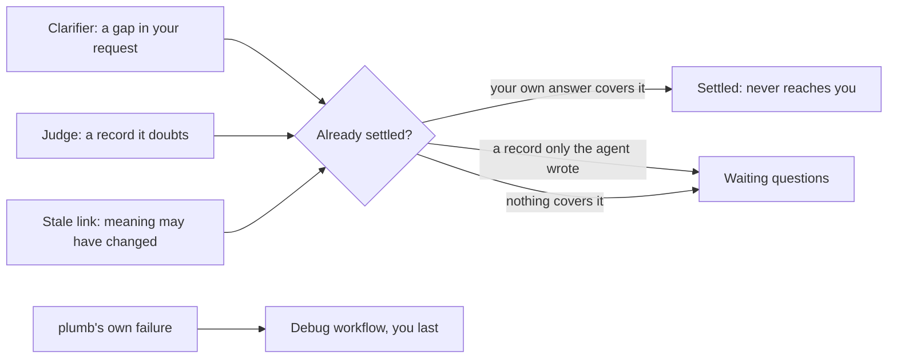
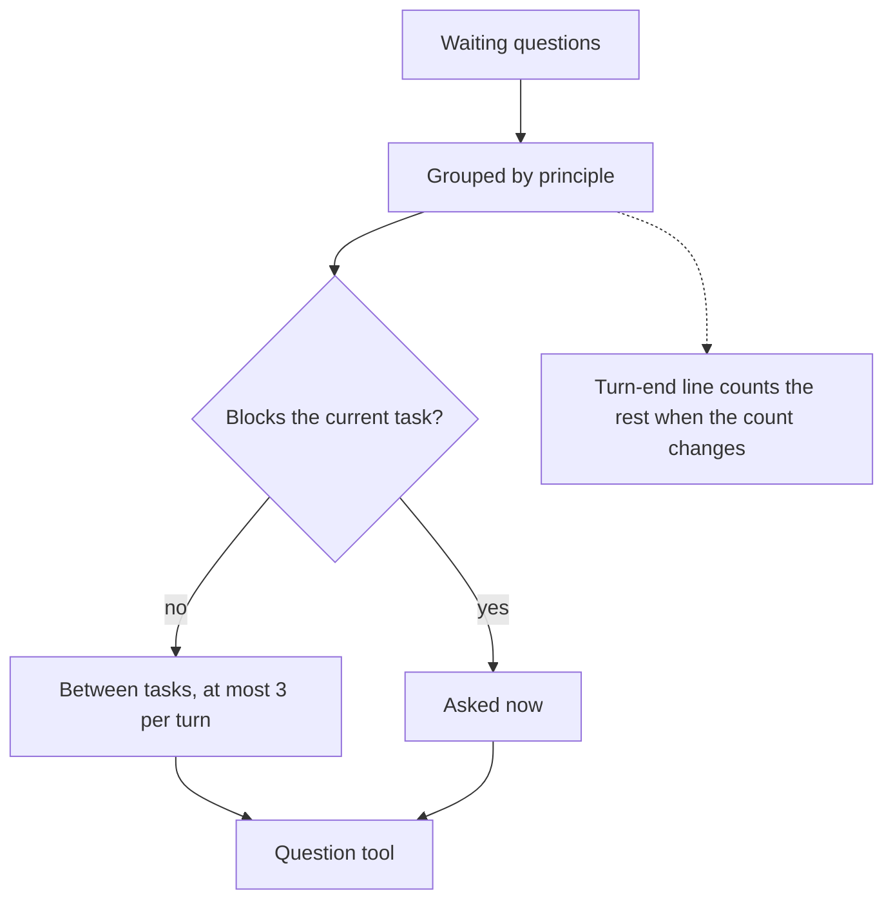
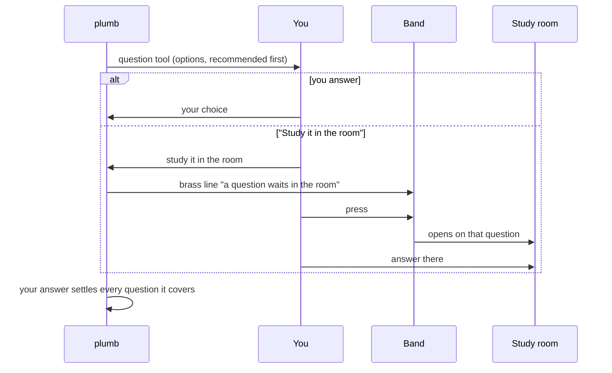

# How a question travels to you

This is the path a question takes from the moment plumb has a doubt to the moment your answer
settles it. It describes plumb once the issue-routing work lands. Each step names the choice you
made that shapes it.

## Where questions come from

Three places raise a question:

- **The clarifier**, when you open an intent loop and your request leaves a gap that changes what
  gets built.
- **The judge**, when it reads a record the agent wrote and can't tell whether it matches what
  you meant.
- **A stale link**, when code under a requirement changed and a model reads the change as
  changing the requirement's meaning.

plumb's own failures don't become questions. They go to the debug workflow, and you hear about
one only as a last resort.

## First stop: is it already settled?

Before anything reaches you, plumb checks whether **your own words** already answer it: a typed
answer, or an option you picked in the question tool. If they do, the question is settled and you
never see it. This holds even while the record that quotes you still waits for the judge.

A record that only the agent wrote settles nothing.

*Example:* on 18 October you said "a typed answer counts; the judge asks again only when it truly
leaves the question open." A later question that this answer covers is settled from it. It isn't
asked again.

## Second stop: pacing

Questions that remain are grouped by the **principle** they hinge on. You're asked the principle
once, and your answer settles every question that hinges on it.

- A question that **blocks** the current task is asked at once.
- The rest are asked **between tasks**, at most three per turn.
- When many wait, you'll be offered the choice of answering them all now or a few at a time,
  with plumb's recommendation. *(You chose this on 21 October. It's being added right after this
  work lands.)*

*Example:* 62 questions wait, and 50 of them hinge on four principles. You're asked at most three
principles this turn. The turn-end line counts the rest, but only when the count changed this
turn. A quiet turn shows nothing.

## Third stop: the question tool, and the room when you ask

Every question comes through the **question tool** in the conversation. It has options, what each
one does and leaves undone, and the recommended one first, with its reason.

When a question has more to see (a diagram, long evidence, two versions side by side), one of
its options is **"Study it in the room."** The room never opens by itself. Choosing that option
puts a brass line in plumb's band, "a question waits in the room", and pressing that line opens
the room on the question.

When questions hinge on something plumb thinks you don't know yet, a **study** is proposed first.
Each such question then offers **"Study it first."**

## What you see

- **The band** shows one line: plumb's state and how many questions await you, plus the intent
  loop's steps while one runs. It shows no cards. Hide keeps it hidden until you press Show.
- **The turn's end** carries at most one plumb line, and only when something changed for you.
- **Nothing is asked twice.** Your answers are logged as your words, and the judge reads them.
