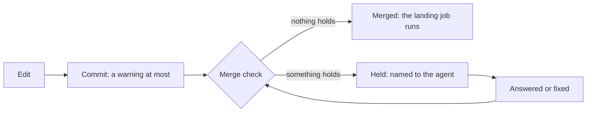
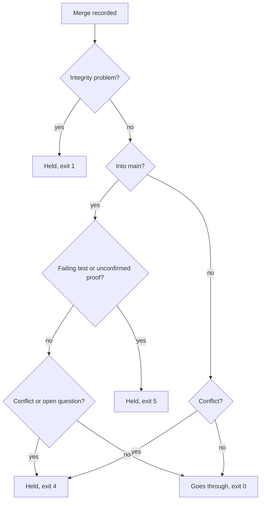

# How merges are held

plumb holds work in one place only: the merge. Everything before it informs you and holds
nothing. This page says what holds a merge, what is only listed, how the rules differ between a
merge into main and a merge into a work branch, and how a held merge is released.

## Nothing before the merge holds

- **A commit is warned, never held.** At commit time the judge reads the diff against the
  requirements the commit says it serves. If the diff doesn't serve one, you get a single warning
  line and the commit goes through (SR-201).
- **Other worktrees only inform.** When another branch is changing a record you're working on,
  plumb says so once per session. Nothing is locked or refused (SR-258).

So the merge is the single hold (SR-260).

## When the check runs

A quick check runs whenever git records a merge, a rebase step, a cherry-pick or a revert. It
runs no tests: it reads the test results already recorded. At push time the pre-push hook runs the
same check with the covering tests, and runs the full suite only when a full verification is
pending (SR-260).

Every way of finishing a merge is checked: `git merge`, `git commit` after a text conflict,
`git merge --continue` and `git pull`. A fast-forward is checked right after git makes it. If
something holds it, main is put back where it was and your local changes are kept (SR-260).

## What holds a merge

You set the list (DEC-252, DEC-255):

| What | Exit code | Into main | Into a work branch |
|---|---|---|---|
| **Integrity**: any validate error, a stale link the merge adds, a new link to a file no test covers, record files unreadable or left out of the commit, colliding ids, a broken log | 1 | holds | holds |
| **A failing test**: a test linked to a touched requirement whose last recorded run fails (a test that never passed counts, DEC-259) | 5 | holds | listed only |
| **An unconfirmed proof**: a requirement the merge delivers whose proof you haven't confirmed | 5 | holds | listed only |
| **A conflict**: an open intent conflict, colliding ids, or a contradiction the judge is sure of | 4 | holds | holds |
| **An open question** to you on a touched record | 4 | holds | listed only |

Tests, questions and proofs hold only a merge into main. A merge into a work branch is held only
by conflicts and integrity (DEC-271).

When several apply, the check reports the first one in the order **1, then 5, then 4**: integrity
first, then tests and proofs, then conflicts and questions. Its report fits on one screen.

### Integrity into main

Into main, any validate error holds the merge, even one already on main before the branch.
A link that is stale in the result but wasn't stale at the merge base holds it too. A link that
was already stale at the base and that the branch doesn't touch does not hold it. Each problem is
named to the agent with the step that clears it, such as "repin after its tests pass". You're asked
nothing (SR-306).

### Which proofs count

Only the requirements the merge **delivers** count: the ones named in the SR trailer of its
commits (DEC-256). The agent shows the proof working, then asks you "Did you see it working?" with
the question tool. Your yes confirms it. A no, or a typed reply, keeps it open (DEC-257).

*Example:* a merge into main delivers SR-001. Its proof was shown but you haven't confirmed it, so
the check exits 5 naming SR-001. After your yes, it exits 0.

## What is only listed, never held

- Records still waiting on a judge, counted in the report. Forty of them still give exit 0.
- Links and exemptions added since an approval. A new `trace.exempt` glob stays unhonoured until
  it is approved by your own words or a question-tool answer. Words the agent quotes don't count.
- Paths that no commit trailer declares.
- Shared log entries not yet committed: the landing job commits them.

## How a held merge is released

- **A conflict:** when an intent conflict holds a merge, git leaves the record unconfirmed with
  the conflict written inside it (DEC-127). You answer the conflict, the quick check passes, and the
  merge can be finished. If you already chose between exactly these two versions earlier, the
  conflict is settled from that answer and you aren't asked again.
- **A rebase, cherry-pick or revert:** the step stops on the record. Continuing with the conflict
  still in it is refused. After your answer the step continues with the version you chose.
- **A failing test, a proof or integrity:** the agent fixes the cause or reruns the tests. For a
  proof, it gets your yes.

## After the merge: the landing job

When a merge into main goes through, by merge commit, fast-forward or a `git commit` that
finishes a held merge, a background landing job runs in this order (SR-296, DEC-160):

1. It tidies away the documents the landed records supersede.
2. It compacts the log.
3. It queues the judge's backlog.
4. It writes every count still showing (stale links, failing or unrun tests, validate errors) as
   debug cases.

The next plumb line tells you what was tidied, how many judge jobs were queued and how many cases
went to debugging. Running the job twice for the same landing changes nothing.

## How sure this is

This page comes from the records, not from watching the code run. Most of the tests linked to
SR-260, SR-296 and SR-306 have no recorded run yet, so these rules are what you decided, not yet
what plumb is proven to do.

Written from: SR-201 A commit is warned, never held, when the judge says its diff does..., SR-258 Intent in flight is shared, and a contradicting capture is caught..., SR-260 The merge is the one hold on unapproved or conflicting intent, SR-296 One landing job runs at each merge into main, SR-306 The merge refuses any validate error or a new stale link, DEC-127 What happens to git's merge when a record has an intent conflict?, DEC-160 Does SR-296 (the landing job) replace SR-286 (the tidy)?, DEC-252 What should hold a merge into main?, DEC-255 Do the integrity checks still hold a merge, beside conflicts,..., DEC-256 Which requirements must have their proof shown and confirmed at a..., DEC-257 How does the owner confirm a proof the agent has shown?, DEC-259 Do tests that never ran, and a pending full run, hold a merge..., DEC-271 Do the test, question and proof holds apply to merges into a work...
