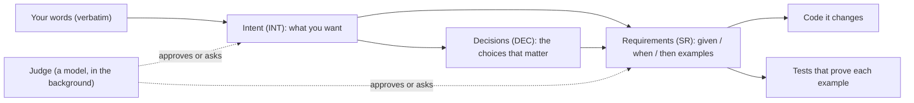
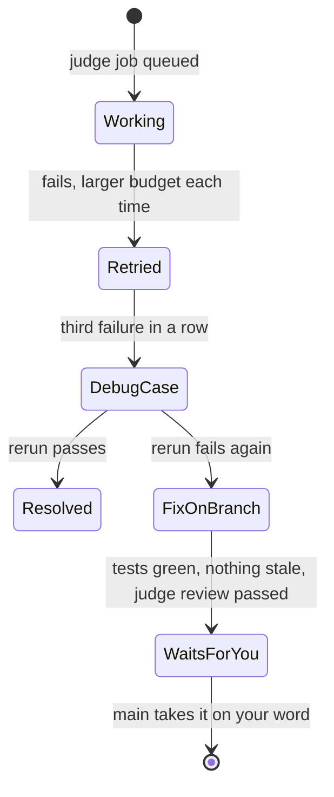

# What plumb does, from request to landed change

plumb keeps what you asked for as small, linked records, has a judge approve them on your behalf, ties them to the code and tests that prove them, and checks all of it before anything merges. This study shows that path once, from the outside in: the shape of the records, the animated trip of one request, what happens when plumb itself gets stuck, and where you still decide.

## The records and what they point at

You never read these. They exist so plumb can answer "why is this here?" and "what did we agree?" later.



An intent holds your request in your own words. Each requirement under it carries examples written as *given, when, then*, and each example is linked to the test that proves it. Decisions record the choices that change what gets built. A judge reads the new records in the background and either approves them on your behalf or comes back with a question only you can settle (SR-273, SR-361).

## One request, start to landed change

Watch for three things: the records are written before the code, the judge never blocks the agent while it works (it runs as a background job), and a merge is checked twice, quickly when git records it and fully when you push (SR-260).

```video
one-request
```

The point of the clip is the order. Records come first and the judge works beside the agent, so a question reaches you at the agent's next chance to ask, grouped by principle, not one by one (SR-361). Tests are linked to examples, so "tests pass" means "the examples you agreed to hold".

## What plumb does when it is stuck

plumb does not ask you about its own failures. When a judge cannot settle after its rounds, or a judge job fails three times, the case goes to a debug workflow that runs in the background (SR-220, DEC-260).



```video
debug-case
```

Watch what the debug workflow is *not* allowed to do: it may rerun a step and fix plumb on a branch, but it never changes what a record means and never approves anything. Landing on main waits for your word (DEC-238).

## Where you still decide

- Questions only you can settle: intent choices and trade-offs, asked in plain words through the question tool.
- Study depth: Markdown, diagrams or video is your press in the band, as this study was (SR-294, SR-371 shows its progress while it is written).
- Landing on main: a fix is ready on a branch; you give the word.

Long plumb work reports its step and progress where you look: the band, the status line, the terminal (SR-272), including the bar you saw while this study was being written.

Written from: SR-272 Long plumb work shows its step and progress, SR-273 plumb's model work runs as batched background jobs, SR-220 What plumb cannot settle goes to a debug workflow, the owner last, SR-245 With no judge reachable, plumb says so once and holds only what..., SR-260 The merge is the one hold on unapproved or conflicting intent, SR-291 The band shows the intent loop's step and the step's progress, SR-294 A new study is announced in plumb's colours, never forced open, SR-361 Every judge question is asked as soon as it is raised, SR-371 A study being written shows its progress in the band, DEC-238 How far does the debug workflow go by itself once a case's rerun..., DEC-260 Does a judge job that fails open a debug case at its first..., DEC-131 Where does the progress of long plumb work show?
