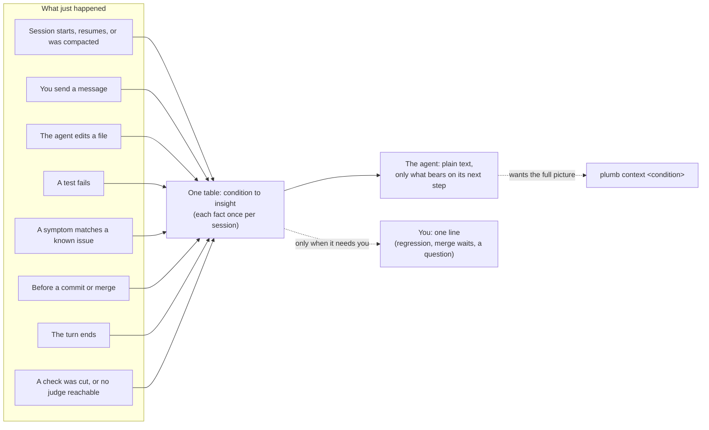
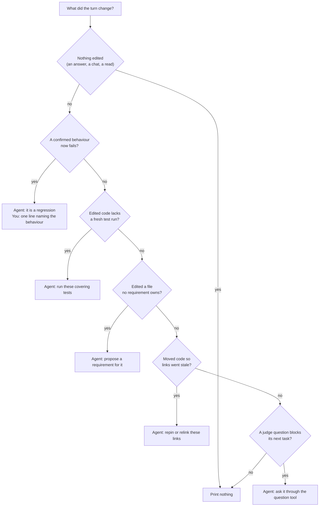

# What plumb tells the agent and you, by condition

This is the design you chose on 2026-10-26, being built now. It answers one question: at each moment of a session, what does plumb say, to whom, and why? Two readers, two rules. The coding agent gets the facts that bear on its next step, each said once. You get one line only when something needs you. Everything else stays quiet, or waits in `plumb status` and in the agent's own `plumb context` command.

## Who hears what

Every hook reads the same table and prints nothing that is not in it (SR-374). That one rule is what stops the old wall of text: before, each hook decided on its own what to print, and the same stale links or counts came back turn after turn.

## The table

| When | What the agent is told |
|---|---|
| Session start, resume, after compaction | The intent being worked on, in one line (its title, the loop's step, what is left); questions waiting; open known issues; records changed since it last saw them. No counts: those live in `plumb status` (DEC-376). |
| Each message | The records your request touches that are new or changed; the intent being worked on when your message does not say it; another branch changing the same record. |
| An edit | The requirement and examples the file serves, its covering tests, the links the edit made stale. |
| A failing test | Whether it is a regression on behaviour you confirmed or a test that never passed, and which example it proves. |
| A known-issue symptom | The issue, its cause, its fix or workaround. |
| Before a commit or merge | Only what would hold it. |
| Turn end | One next action (below). |
| A check cut or no judge | Which step was skipped, once. |

"Once per session per state" is the filter on every row: a fact the agent was told is not told again until it changes. Nothing applies, nothing is printed.

## The turn's end: one next action

The turn's end looks at what the turn changed and picks exactly one thing for the agent to do next (SR-373). The order matters: the most urgent wins.

Inside an intent loop, the band shows the loop's step and nothing else is printed to you. There are no cards: nothing you read and press. The card text the agent used to receive is replaced by that one action (DEC-384).

"A fresh test run" now means the files the test covers have not changed since it passed, not that the whole tree is unchanged (DEC-377). Before, every commit made every test stale, so "0 tests fresh" was the permanent state and the turn's end always asked for a run.

## The judge never stops the agent

The judge reads the records in the background and never inside a hook or a command the agent runs (SR-378). Its questions reach the agent as text and are asked between tasks. They never refuse an edit. Outside an intent loop, the only thing that holds the agent's edits is a request that contradicts or extends behaviour you confirmed.

This is the part you hit in this very session: a judge question plumb never handed to the agent kept refusing its writes. Under this design that cannot happen, because questions no longer gate the agent's tools at all.

## When the agent wants more

The table is deliberately short. When the agent needs the whole picture of one condition (every link of a file, every example and its test state, the drift around it), it runs `plumb context <condition> [<path or id>]` (DEC-383). It gets the same facts without the once-per-session filter, in full. You never need to run it.

## What to watch for once it lands

- A turn that only answers a question ends with no plumb output at all.
- After the conversation is compacted, the agent's next message starts knowing which intent it is on.
- The session brief tells the agent what changed and what blocks, not a list of counts.
- You see a plumb line only for a regression, a waiting merge, or a question.

Written from: INT-114 Resolve the critical and high findings of the 2026-10-26 design..., SR-373 A turn ends with one next action for the agent and at most one..., SR-374 plumb tells the agent one table of insights by condition, SR-378 An ordinary message never blocks the agent on the judge, DEC-376 What does the session brief show?, DEC-377 When is test evidence fresh?, DEC-383 What is the agent's on-demand command for a condition's full picture?, DEC-384 What does the agent get instead of the owner's card text at turn end?
